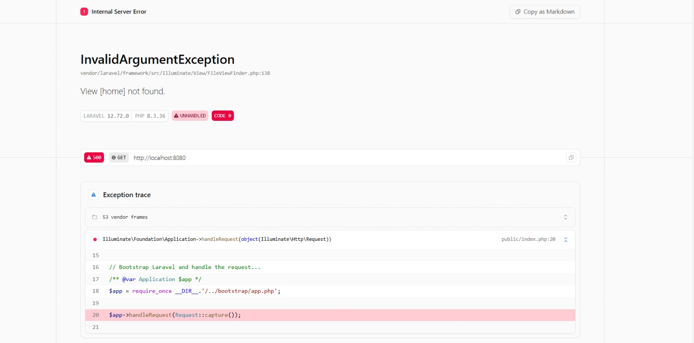
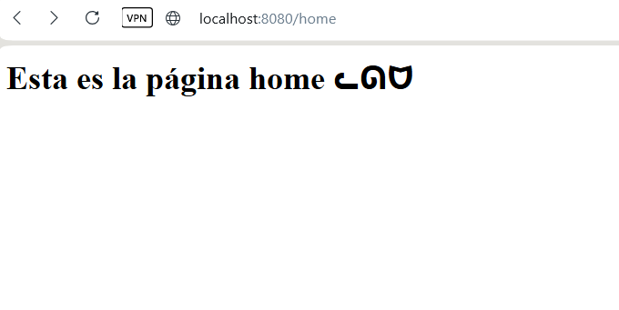
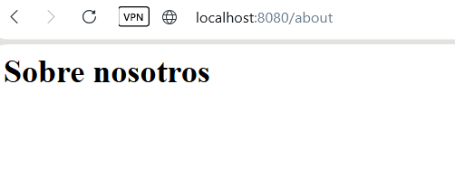
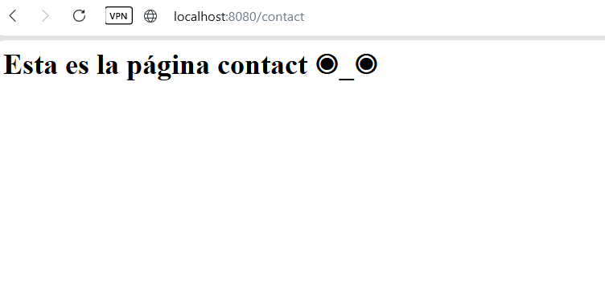

# Tema 01: Instalación con Docker

| | |
|---|---|
| **Fecha de inicio** | 09/11/2026 |
| **Fecha de fin** | 16/11/2026 |
| **Tiempo dedicado** | 5 horas |
| **Rama de Git** | `tema01` |

---

## 1. 🎯 Objetivo del tema

Instalación de docker y la creación del proyecto laravel.

## 2. 🛠️ Desarrollo paso a paso

<!-- Un apartado por cada paso importante. Para cada uno:
     - Qué haces y POR QUÉ.
     - El comando o el código, en un bloque de código (nunca como captura).
     - Una captura solo si aporta algo visual (navegador, resultado, estructura...). -->

### 2.1 Creación de vistas

Se van a crear 3 vistas llamadas home, about y contact.

### 2.2 Definición de rutas
Se modifica el fichero *route/web.php* de la siguiente forma:

```php
 Route::view('/', 'home')->name('home');
 Route::view('/about', 'about')->name('about');
 Route::view('/contact', 'contact')->name('contact');
```

---

## 3. 📋 Resumen de comandos utilizados

| Comando | Para qué sirve |
|---------|----------------|
| `composer` | ejecuta el gestor de dependencias oficial de PHP para instalar, actualizar y administrar librerías y paquetes de terceros en un proyecto|
| `docker compose` | gestiona aplicaciones formadas por varios contenedores a partir de un archivo de configuración YAML |

---

## 4. 🐞 Problemas encontrados y soluciones

<!-- Documenta TODOS los problemas, aunque te parezcan tontos.
     Copia el error como texto, no como captura.
     Si no has tenido ningún problema, documenta al menos algo que hayas tenido que investigar. -->


### Problema 1: Comprobación del funcionamiento de laravel después de su instalación.

**Qué estaba haciendo:** Comprobar el correcto funcionamiento de laravel una vez creado el proyecto básico. 

**Error:**

```
Acceso denegado.
```

**Causa:** posible problema de permisos.

**Solución:**
Ejecutamos en una terminal los siguientes comandos :
 ```bash
 docker exec -it proyecto-php-1 bash
	php artisan key:generate
	chmod -R 775 storage bootstrap/cache
	chown -R www-data:www-data storage bootstrap/cache
 ```
Después añadimos en .env

  ```bash
  Fichero .env:
DB_HOST=mysql
DB_PORT=3306
DB_DATABASE=test
DB_USERNAME=alumno
DB_PASSWORD=alumno
SESSION_DRIVER=file
 ```

**fuente:** chatGPT
### Problema 2: Comproación de las páginas *home.blade.php , about.blade.php , contact.blade.php*

**Qué estaba haciendo:** Después de crear las dichas páginas en *src/resources/views/landing* y haber añadido la ruta en *src/routes/web.php* he ido a comprobar su vista.

**Error:**

El error es descrito como un argumento inválido.



**Causa:** posible ruta mal definida.

**Solución:** 
El problema se soluciona después de modificar la ruta home, para que no existan error entre rutas raices pasa a ser */home* y al añadir en todas las rutas *landing.*

```bash
Route::view('/', 'landing.index')-> name('index');
Route::view('/home', 'landing.home')->name('home');
Route::view('/contact', 'landing.contact')->name('contact');
Route::view('/about', 'landing.about')-> name('about');

```

**Fuente:** Badr
## 5. ✅ Resultado final

vista *home.blade.php*



vista *about.blade.php*



vista *contact.blade.php*



## 6. 💭 Conclusiones

- **Qué he aprendido:** Hemos aprendido a instalar Docker, crear un proyecto Laravel y configurar sus rutas y vistas para mostrar diferentes páginas web.

- **Qué me ha costado más:** Mi mayor conflicto se hubican en las primeras horas del proyecto. Como es un nuevo tema, con nuevas herramientas que tener en cuenta me sentía perdida entre archivos. Todavía siento algo de confusión a la hora de encontrar dónde occurre cada cosa.

- **Qué haría diferente / dudas pendientes:** Diría que el problema no está en las clases guiadas de teams, ni en el temario, ni en nada relacionado con la clase. Creo que aquello que tengo que repasar se resolverá con la práctica individual de ejercicios. Verme parada en mis propios errores y aprender a solucionarlos. 

